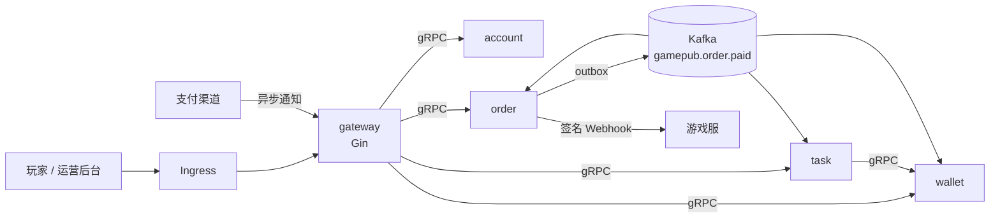

# gamepub · 游戏发行平台核心后端

为多款游戏提供**账户中心、钱包资金、支付订单、任务活动与运营权限**服务。按领域拆分为 5 个 Go 服务，经 gRPC 通信、Kafka 承载异步事件，部署于 Kubernetes；同时内置一套**代码审计与安全评审**的工程化设施：审查清单、风险分级、Semgrep 自定义规则、CI 安全门禁和 AI 辅助审查工具。

技术栈：Go 1.26 · Gin · gRPC / Protobuf (buf) · GORM · MySQL 8 · Redis · Kafka (kafka-go) · Kubernetes · golangci-lint · gosec · Semgrep · govulncheck · Trivy · Claude API



详细架构、充值时序、TCC 流程与一致性策略见 [docs/architecture.md](docs/architecture.md)。

## 服务

| 服务 | 职责 | 关键设计 |
|---|---|---|
| [gateway](cmd/gateway) | 对外 HTTP API 与运营后台 | 鉴权/限流挂在路由分组上；后台按账户服务实时角色 + 权限点授权；审计日志；上传校验 |
| [account](cmd/account) | 注册、登录、资料、角色 | 手机号 AES-GCM 加密 + HMAC 盲索引；Ed25519 JWT；登录防枚举；资料缓存（singleflight / 空值缓存 / 延迟双删） |
| [wallet](cmd/wallet) | 平台币余额与流水 | 幂等键 + 唯一索引 + 乐观锁；TCC（空回滚、防悬挂）；分布式锁下的定时对账 |
| [order](cmd/order) | 充值订单、支付回调、发货通知 | 服务端定价；归属校验；验签 + 防重放 + 金额校验；事务性 Outbox；SSRF 防护 + 熔断的发货 Webhook |
| [task](cmd/task) | 任务进度与奖励 | 事件驱动进度（消费幂等）；领奖状态机 + 钱包幂等入账；跨周期补偿 |

## 目录

```
api/proto, api/gen     gRPC 接口定义与生成代码（buf）
cmd/<service>          各服务入口
internal/<domain>      领域服务：account / wallet / order / task / gateway
internal/app           服务启动骨架（信号、优雅退出、后台任务）
pkg/                   可复用的安全与治理组件（见下表）
migrations/            各服务库的 MySQL DDL
deploy/                Dockerfile、docker-compose、K8s 清单（kustomize）
security/              Semgrep 自定义规则与用例、Trivy 配置
tools/ai-review        AI 辅助代码审查工具（独立 Go module）
tools/devkeys          本地开发密钥生成
docs/                  架构说明与审计文档
```

| 组件 | 作用 |
|---|---|
| [pkg/netguard](pkg/netguard) | SSRF 防护：URL 前置校验 + 建连时校验最终 IP（防 DNS Rebinding / 302 绕过），禁用环境代理 |
| [pkg/resilience](pkg/resilience) | 出站调用治理：单次超时、仅幂等请求重试（逐次重签）、按 host 熔断、响应体上限 |
| [pkg/signature](pkg/signature) | 回调验签：HMAC + 时间窗 + nonce 防重放，存储故障时拒绝，业务失败释放 nonce |
| [pkg/sqlsafe](pkg/sqlsafe) | 排序字段白名单、LIKE 转义、分页与深分页上限 |
| [pkg/upload](pkg/upload) | 魔数识别、尺寸检查（防像素炸弹）、重新编码（去 EXIF / 附加载荷）、服务端生成存储 key |
| [pkg/mq](pkg/mq) | Kafka 可靠消费：有限重试 → 死信 → 提交位点；死信写入成功前不前进；消费幂等表 |
| [pkg/redislock](pkg/redislock) | SET NX PX + 随机 token + Lua 比对释放 / 续期 |
| [pkg/ratelimit](pkg/ratelimit) | Redis Lua 令牌桶，Redis 故障降级为有上限的本地限流 |
| [pkg/mask](pkg/mask) · [pkg/logx](pkg/logx) | 统一脱敏组件；slog 按字段名自动脱敏、携带 request_id |
| [pkg/grpcx](pkg/grpcx) | 内部令牌（常量时间比较）、错误脱敏、默认超时、仅 UNAVAILABLE 重试 |
| [pkg/auth](pkg/auth) · [pkg/cryptox](pkg/cryptox) | Ed25519 JWT（限定算法/签发方/受众）；AES-GCM 字段加密与盲索引 |

## 审计要点与代码对照

每个审计结论都落到可执行的修复和回归测试上：

| 审计点 | 实现 | 回归测试 / 规则 |
|---|---|---|
| 按 ID 查询他人订单（水平越权） | `WHERE order_no = ? AND user_id = ?`，他人订单与不存在同为 404 | `TestHorizontalPrivilegeEscalationBlocked`；Semgrep `order-lookup-without-owner` |
| 鉴权中间件遗漏 | 公开接口白名单，鉴权挂在分组 | `TestEveryNonPublicRouteRequiresAuth` 遍历全部路由 |
| 后台越权 / 令牌角色不可信 | `loadStaff` 实时查角色 + `requirePerm` | `TestAdminRoutesRequireStaffAndPermission` |
| 批量接口缺限流与上限 | 50 条上限 + 独立限流桶；按手机号与 IP 双维度登录限流 | `TestBatchQueryLimit`、`TestLoginRateLimitedPerPhone`、`TestSpoofedForwardedForIgnored` |
| GORM 动态排序 / 拼接注入 | `sqlsafe.SortFields` 白名单、参数化 | `TestOrderByWhitelist`、`TestAdminListOrdersFilters`；Semgrep `gorm-*` |
| 文件上传 | 魔数 + 解码 + 重编码 + 服务端 key + 0600 | `TestInspect`、`TestAvatarUpload`、`TestLocalStorageRejectsTraversal` |
| 支付回调验签与重放 | 原始报文 HMAC、时间窗、nonce；金额与渠道交易号唯一 | `TestPayNotifyRejections`、`TestForgedRequestDoesNotBurnNonce` |
| Webhook / URL 抓取 SSRF | 协议、端口、内网 IP 校验；建连时二次校验；NetworkPolicy 出口兜底 | `TestRedirectToInternalBlocked`、`TestGameAppDeliveryURLSSRF` |
| 第三方调用拖垮主链路 | 超时、幂等重试、按 host 熔断 | `TestBreakerOpensPerHost`、`TestPrepareRunsPerAttempt` |
| 日志 / 错误响应泄露 | 统一脱敏；gRPC 与 HTTP 层错误脱敏 | `TestSensitiveFieldsMasked`、`TestInternalErrorsNotLeaked` |
| 明文密钥 | 只从 K8s Secret 注入，缺失即启动失败；按服务拆分 | `TestShortTokenRejected`；Semgrep `hardcoded-credential` |
| 钱包并发扣减 | 乐观锁 + `available + ? >= 0` 条件 + 唯一索引 | `TestConcurrentDebitsNeverOverdraw`、`TestConcurrentSameBizIDCreditsOnce` |
| TCC 空回滚与悬挂 | xid 唯一分支表 | `TestTCCEmptyRollbackAndSuspension` |
| 对账 | SUM(流水) 对比账户总额，事务内复核 | `TestReconcileDetectsMismatch` |
| Kafka 位点 / 重试 / 死信 / 幂等 | 见 `pkg/mq` | `TestNoCommitBeforeDLQSucceeds`、`TestProgressFromEventsIsIdempotent` |
| 缓存一致性与分布式锁误释放 | 双删 + singleflight；token + Lua | `TestSingleflightCollapsesConcurrentMisses`、`TestExpiredHolderCannotReleaseOthersLock` |

完整的审查清单、分级标准和一份样例审计报告（12 条发现 + 1 条经人工复核判定不成立的误报）：

- [docs/audit/checklist.md](docs/audit/checklist.md) 代码审查清单
- [docs/audit/risk-rating.md](docs/audit/risk-rating.md) 高 / 中 / 低风险分级、修复时限与复审闭环
- [docs/audit/go-concurrency.md](docs/audit/go-concurrency.md) Go 并发与资源审查要点
- [docs/audit/sample-report.md](docs/audit/sample-report.md) 样例审计报告

## CI 安全门禁

[.gitlab-ci.yml](.gitlab-ci.yml) 中以下任务失败即阻断合并：

| 阶段 | 工具 | 规则 |
|---|---|---|
| lint | golangci-lint（[配置](.golangci.yml)）、buf lint / breaking | 含 gosec、bodyclose、noctx、sqlclosecheck、errorlint 等 |
| test | `go test -race` | 两个 module |
| security | gosec | medium 及以上 |
| security | Semgrep | 先跑 `semgrep --test` 校验自定义规则，再扫描；ERROR 级阻断 |
| security | govulncheck | 代码可达的已知漏洞 |
| security / image | Trivy | 依赖漏洞、Dockerfile / K8s 配置缺陷、误提交密钥；镜像 HIGH+ |

**AI 辅助审查**（[tools/ai-review](tools/ai-review)）在 MR 流水线中运行，不阻断：收集 diff → 外发前脱敏 → Claude 按审查清单输出结构化结论 → 与 Semgrep 结果按文件和行号交叉验证 → 生成报告初稿并评论到 MR。所有结论标注“待人工复核”；模型输出中的 @提醒、HTML 会被转义（diff 内容可能包含提示注入）；引用了 diff 之外文件的结论会被丢弃。

## 本地运行

需要 Go 1.26+、buf（改 proto 时）、Docker（跑完整环境时）。

```bash
make keys      # 生成 .env（本地随机密钥，已在 .gitignore 中）
make up        # MySQL / Redis / Kafka + 5 个服务，网关监听 127.0.0.1:8080
make test      # 单元测试（内存 SQLite + miniredis，不依赖外部服务）
make lint security
```

给账号授予后台角色（仅运维命令行，无网络接口）：

```bash
docker compose -f deploy/docker-compose.yml exec account /app grant-role 13800000000 finance
```

## 验证结果

在 Go 1.26.9 下本地实测：

- `go test ./...`：全部通过；安全组件覆盖率 76%–96%（netguard 86%、sqlsafe 91%、ratelimit 96%、mask 95%）
- golangci-lint：0 issues（两个 module）
- gosec：0 issues
- govulncheck：0 个可达漏洞（期间发现 `golang.org/x/net` v0.57.0、`quic-go` v0.59.0 的可达漏洞，已升级修复）
- Semgrep：自定义规则 16/16 用例通过；对全仓库扫描（含 `p/golang`）无未处理结果
- 所有 YAML（K8s、compose、CI、规则）可正常解析

## 已知限制

- 单元测试使用单连接 SQLite，验证的是业务逻辑与幂等语义；MySQL 的行锁、间隙锁与 RR 快照行为需要真实 MySQL 集成测试覆盖。
- `go test -race` 需要 CGO，在 CI（Linux）中执行。
- 支付渠道为模拟渠道 `mockpay`（HMAC 签名），接入真实渠道需替换为其证书验签方式。
- JWT 暂无主动吊销；人工调账暂无双人复核。见样例报告“遗留风险与建议”。
