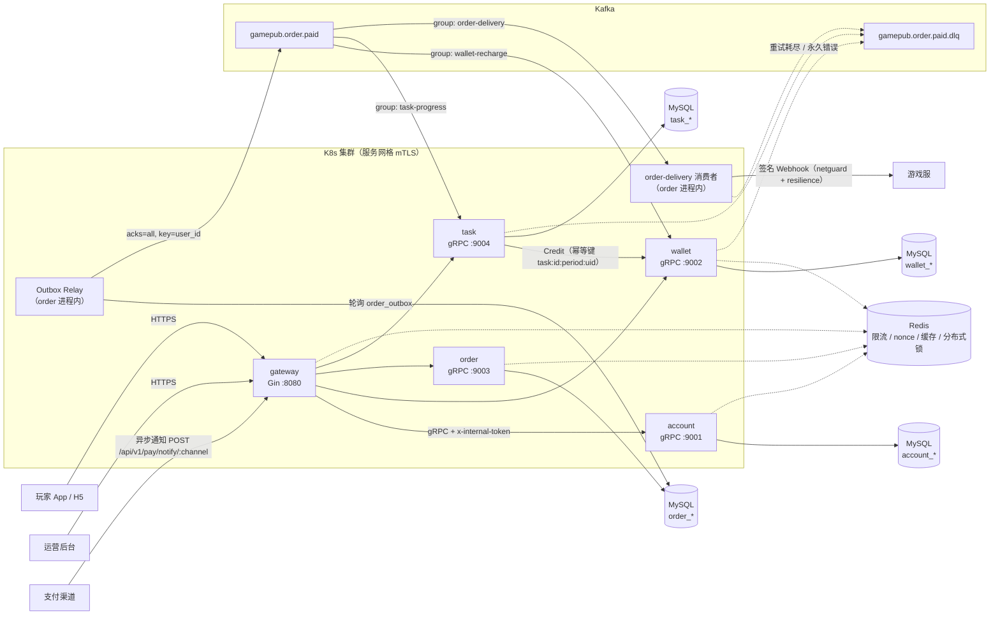
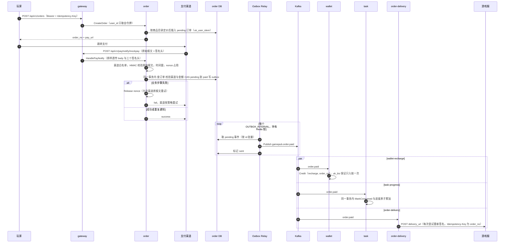
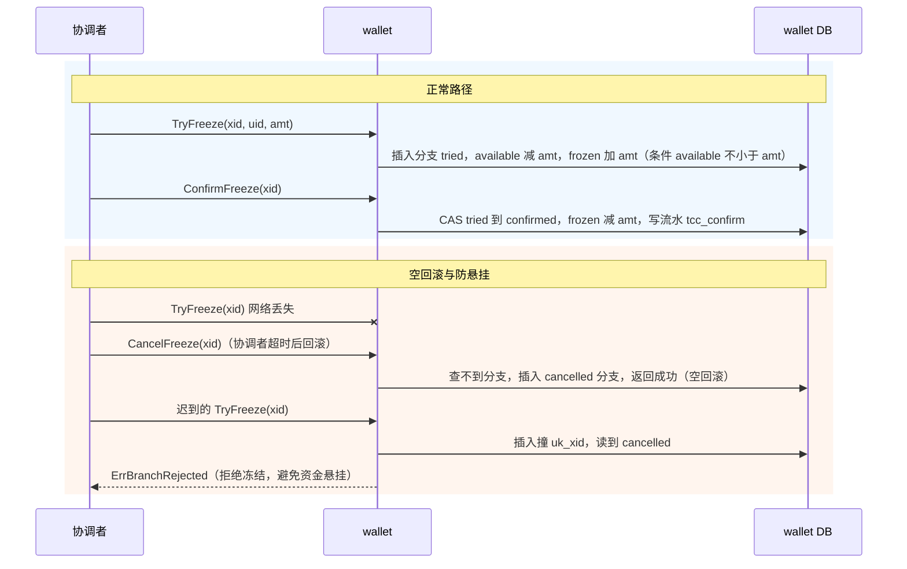

# 架构说明

游戏发行平台核心后端（账户 · 资金 · 订单 · 任务 · 权限）。Go monorepo，模块名 `gamepub`，Go 1.26。

本文描述服务划分、调用与消息拓扑、充值主链路、TCC 资金冻结、一致性保障手段和安全边界。实现细节以代码为准，文中链接均指向仓库内文件。

## 1. 服务职责

| 服务 | 入口 | 协议 / 默认端口 | 职责 | 后台任务 |
|---|---|---|---|---|
| gateway | [cmd/gateway/main.go](../cmd/gateway/main.go) | HTTP（Gin）`:8080` | 唯一对外入口：鉴权（JWT 校验，只持公钥）、后台 RBAC、限流、参数校验、错误脱敏，经 gRPC 转发 | 无 |
| account | [cmd/account/main.go](../cmd/account/main.go) | gRPC `:9001` | 注册登录、令牌签发（Ed25519 私钥只在此）、资料与角色、手机号加密存储、资料缓存 | 运维子命令 `account grant-role` |
| wallet | [cmd/wallet/main.go](../cmd/wallet/main.go) | gRPC `:9002` | 平台币余额与流水、入账/扣减、TCC 冻结、对账 | `wallet-recharge` 消费者、定时对账 |
| order | [cmd/order/main.go](../cmd/order/main.go) | gRPC `:9003` | 下单（服务端定价）、支付回调验签、事务性发件箱、游戏发货 Webhook | Outbox Relay、`order-delivery` 消费者 |
| task | [cmd/task/main.go](../cmd/task/main.go) | gRPC `:9004` | 任务进度（事件驱动）、领奖（经钱包幂等入账） | `task-progress` 消费者、领奖补偿 |

公共骨架在 [internal/app/app.go](../internal/app/app.go)：`app.Main` 用 `errgroup` 统一管理 gRPC 服务、调试端口和后台任务的生命周期。任一后台任务返回错误时整个进程退出，由 K8s 重启，不会停在半工作状态。调试端口（pprof）由 `DEBUG_ADDR` 控制，默认 `127.0.0.1:6060`，设为 `off` 关闭，见 [pkg/obs/debug.go](../pkg/obs/debug.go)。

接口定义在 `api/proto/*/v1/*.proto`，生成代码在 `api/gen`（不要手改）。

## 2. 拓扑

要点：

- 主题与死信主题名定义在 [internal/events/events.go](../internal/events/events.go)（`TopicOrderPaid`、`TopicOrderPaidDLQ`）。三个消费组各自独立维护位点，互不影响。
- 生产者 `acks=all`，按 key 哈希分区，key 为 `user_id`，同一用户的事件有序；禁止自动建 topic。见 [pkg/mq/kafka.go](../pkg/mq/kafka.go)。
- 消费端关闭自动提交（`FetchMessage` + 同步 `CommitMessages`），只有在“处理成功或已写入死信”之后才提交，见 [pkg/mq/consumer.go](../pkg/mq/consumer.go)。
- 只有 order 服务会向外网发起 HTTP 请求（游戏服 Webhook），统一走 `netguard` + `resilience`。

## 3. 充值主链路

对应实现：

| 步骤 | 代码 | 关键点 |
|---|---|---|
| 下单 | [service.go](../internal/order/service.go) `CreateOrder` | 请求体没有金额字段，金额来自 `LookupProduct`；幂等键按用户隔离 |
| 回调入口 | [handler_trade.go](../internal/gateway/handler_trade.go) `payNotify` | 网关不解析报文、不持有渠道密钥；按渠道协议应答 `success` / `fail` |
| 验签 | [signature.go](../pkg/signature/signature.go) `Verify` | 对原始报文验签，`hmac.Equal` 常量时间比较；验签通过后才占用 nonce；nonce 存储不可用时拒绝（fail closed） |
| 状态推进 | [callback.go](../internal/order/callback.go) `applyPayNotify` | 渠道一致、金额一致、`UPDATE ... WHERE status = 'pending'` CAS，outbox 同事务写入 |
| nonce 释放 | [callback.go](../internal/order/callback.go) `HandlePayNotify` | 业务失败时 `Release`，渠道原样重试不会被当成重放 |
| 投递 | [outbox.go](../internal/order/outbox.go) `Relay.tick` / `RunOnce` | 至少一次；批次间 `Refresh` 续锁，续锁失败立即停止 |
| 入账 | [consumer.go](../internal/wallet/consumer.go) `HandleOrderPaid` | 业务单号 = `order_no`；格式错误与参数冲突返回 `mq.Permanent`，直接进死信 |
| 任务进度 | [service.go](../internal/task/service.go) `HandleOrderPaid` | `mq.MarkConsumed` 与 upsert 在同一事务 |
| 发货 | [delivery.go](../internal/order/delivery.go) `HandleOrderPaidDelivery` | 投递前重新做 SSRF 校验；游戏服 4xx 视为永久错误 |

## 4. TCC 资金冻结

钱包对外提供 `TryFreeze` / `ConfirmFreeze` / `CancelFreeze`（[wallet.proto](../api/proto/wallet/v1/wallet.proto)），供跨服务购买等场景的外部协调者调用。仓库内没有协调者实现。分支表 `wallet_tcc_branch` 以 `xid` 唯一（`uk_xid`），同时承担 Try 幂等、空回滚记录和防悬挂判定，见 [tcc.go](../internal/wallet/tcc.go)。

分支状态迁移：

| 当前状态 | Try | Confirm | Cancel |
|---|---|---|---|
| 不存在 | 插入 tried 并冻结；余额不足时整个事务回滚，不留分支 | `ErrBranchNotFound` | 插入 cancelled（空回滚） |
| tried | 参数一致返回 tried（幂等），不一致返回 `ErrIdempotencyConflict` | CAS 到 confirmed | CAS 到 cancelled 并解冻 |
| confirmed | 返回 confirmed | 幂等返回 | `ErrBranchRejected` |
| cancelled | `ErrBranchRejected`（防悬挂） | `ErrBranchRejected` | 幂等返回 |

Confirm 与 Cancel 并发时由 `transit` 的 `WHERE status = 'tried'` CAS 决定唯一赢家，输的一方重试后按新状态处理。冻结、确认、取消都会 `version + 1`，和 Credit/Debit 共用乐观锁版本号。

回归测试：[service_test.go](../internal/wallet/service_test.go) `TestTCCTryConfirm`、`TestTCCTryCancel`、`TestTCCEmptyRollbackAndSuspension`、`TestTCCTryInsufficientRollsBackBranch`。

## 5. 一致性策略

原则：分布式锁只用来减少并发，资金正确性由数据库约束和条件更新兜底，对账负责发现前面所有手段漏掉的问题。

| 机制 | 位置 | 保证什么 | 不保证 / 前提 |
|---|---|---|---|
| 下单幂等键 | `order_order.uk_user_idem (user_id, idempotency_key)` | 客户端重复提交只生成一笔订单；并发插入冲突时回读先落库的那笔 | 键按用户隔离；`IdempotencyKey` 为 `*string`，未传时为 NULL，不参与唯一约束 |
| 订单状态 CAS | `callback.go` `UPDATE ... WHERE id = ? AND status = 'pending'` | 回调并发时只有一个请求能推进到 paid，outbox 只写一次 | 依赖事务；`RowsAffected = 0` 返回 Aborted，由渠道重试 |
| 渠道交易唯一 | `order_order.uk_channel_trade (channel, trade_no)` | 一笔渠道交易只能核销一个订单 | pending 订单的 `trade_no` 为 NULL，不互相冲突 |
| 金额 / 渠道校验 | `applyPayNotify` | 签名合法但金额或渠道不符时不推进状态，并记 ERROR | 金额以订单表为准，不信任回调报文 |
| 事务性发件箱 | `order_outbox`，与订单状态同事务 | 订单变为 paid 与“事件待发送”原子；进程崩溃不丢事件 | 至少一次投递，可能重复，消费方必须幂等 |
| 钱包流水唯一 | `wallet_ledger.uk_biz (biz_type, biz_id)` | 同一业务单据无论重复或并发多少次，最多一条流水；冲突时整个事务回滚，包括已执行的余额更新 | 同一 biz_id 参数不一致返回 `ErrIdempotencyConflict` |
| 乐观锁 + 余额条件 | `wallet/service.go` `changeOnce`：`WHERE version = ? AND available + ? >= 0` | 防丢失更新；在 SQL 层杜绝透支 | 冲突有限次随机退避重试，超过返回 `ErrConcurrentUpdate` |
| 账户先建后改 | `ensureAccount` 在事务外 `INSERT ... ON CONFLICT DO NOTHING` | 避免 MySQL RR 下事务内“查不到、插入冲突、再查仍读旧快照”的死循环 | 仅首次入账走此路径 |
| TCC 分支唯一 | `wallet_tcc_branch.uk_xid` | Try 幂等、空回滚、防悬挂 | 见第 4 节 |
| 消费去重 | `mq_consumed.uk_consumer_msg (consumer, msg_id)`，`mq.MarkConsumed` | 与业务写在同一事务：重复投递整条跳过；处理失败时标记也一起回滚 | 必须在同一 `tx` 内调用 |
| 进度原子累加 | `task_user_task.uk_user_task_period` + `ON CONFLICT DO UPDATE progress = progress + ?` | 并发事件不丢失进度 | — |
| 领奖状态机 | `completed → claiming → claimed`，钱包幂等键 `task:{id}:{period}:{uid}` | 连点或并发领奖最多入账一次；入账后崩溃由 `CompensateClaims` 补齐 | 补偿依赖钱包幂等，可多副本同时执行 |
| 消费位点 | `mq.Consumer`：成功或已写入死信后才 Commit | 不因跳过失败消息而隐式确认丢失；死信写不进去时阻塞分区并告警 | 至少一次 |
| 回调防重放 | Redis `SET NX PX` 存 nonce，TTL 为 2 倍时间窗 | 截获的合法通知不能重复投递 | Redis 不可用时拒绝，由渠道重试 |
| 对账 | [reconcile.go](../internal/wallet/reconcile.go) | 定期核对 `SUM(流水.amount)` 与账户总额（可用 + 冻结）；批量初筛后单用户事务内复核，差异写 `wallet_reconcile_diff` | 只发现，不自动修复；修复走人工调账 |

全部唯一约束：

| 表 | 唯一约束 |
|---|---|
| `account_user` | `uk_phone_hash`（手机号盲索引） |
| `order_order` | `uk_order_no`、`uk_user_idem`、`uk_channel_trade` |
| `order_game_app` | 主键 `game_id` |
| `wallet_account` | `uk_user` |
| `wallet_ledger` | `uk_biz` |
| `wallet_tcc_branch` | `uk_xid` |
| `task_user_task` | `uk_user_task_period` |
| `mq_consumed`（各服务各一份） | `uk_consumer_msg` |

唯一键冲突统一由 [dbx.IsDuplicate](../pkg/dbx/dbx.go) 识别（`TranslateError` + MySQL 1062 + SQLite 文本兜底），幂等分支都依赖它。

## 6. 安全边界

### 6.1 对外接口

公开接口只有 4 个，以白名单形式列在 [router.go](../internal/gateway/router.go) 的 `publicRoutes`：

| 接口 | 保护方式 |
|---|---|
| `GET /healthz` | 无 |
| `POST /api/v1/auth/register` | 按 IP 限流 |
| `POST /api/v1/auth/login` | 按 IP 限流 + 按手机号摘要限流；登录失败统一错误；用户不存在也做一次 bcrypt 比较，使耗时一致 |
| `POST /api/v1/pay/notify/:channel` | 渠道签名 + 时间窗 + nonce；按来源 IP 限流 |

其余接口全部挂在分组上：

- 玩家分组 `/api/v1`：`authn` + 按用户限流 + 请求体上限。所有 handler 的 `user_id` 只从令牌取（`userID(c)`），不读 query/body/path。批量查询另有更严格的限流。
- 后台分组 `/admin/v1`：`authn` → `loadStaff` → `auditLog`，每个路由再挂 `requirePerm`。

[router_test.go](../internal/gateway/router_test.go) 的 `TestEveryNonPublicRouteRequiresAuth` 遍历全部路由，断言白名单外的接口在无令牌、非法令牌、被篡改令牌下都返回 401；`TestAdminRoutesRequireStaffAndPermission` 断言后台接口对普通玩家和已停用员工返回 403。新增路由漏挂中间件会直接导致 CI 失败。

网关默认不信任任何反向代理（`TrustedProxies` 为空），防止伪造 `X-Forwarded-For` 绕过按 IP 限流；生产需配置为 Ingress 网段。

### 6.2 后台权限

- 令牌由 account 用 Ed25519 私钥签发，网关只持有公钥，校验时限定算法、issuer、audience，并要求必须有 exp，见 [jwt.go](../pkg/auth/jwt.go)。
- 后台权限不信任令牌中的 `roles`。`loadStaff` 每次请求向 account 实时查询角色与状态，降权或停用不必等令牌过期。
- 角色与权限点静态声明在 [rbac.go](../internal/rbac/rbac.go)：

| 角色 | order:read | game:write | wallet:read | wallet:adjust |
|---|:-:|:-:|:-:|:-:|
| cs（客服） | ✓ | | | |
| ops（运营） | ✓ | ✓ | | |
| finance（财务） | ✓ | | ✓ | ✓ |
| admin | ✓ | ✓ | ✓ | ✓ |

- 授予角色只有运维命令 `account grant-role <phone> <role>`（Pod 内 `kubectl exec` 执行），没有任何网络接口。
- 人工调账（`POST /admin/v1/wallet/adjust`）要求独立权限点、填写原因、携带幂等键，单笔上限 ±100000，并写审计日志，见 [handler_admin.go](../internal/gateway/handler_admin.go)。

### 6.3 服务间调用

- 所有 gRPC 服务端经 [grpcx.NewServer](../pkg/grpcx/server.go) 创建，拦截器顺序：panic 恢复 → request_id → 访问日志（不记请求体）→ 内部令牌校验（`x-internal-token`，常量时间比较，启动时要求不少于 32 字节；健康检查除外）→ 错误脱敏（非显式 gRPC status 一律替换为 `internal error`）。
- 传输层由服务网格 Sidecar 提供 mTLS（`grpcx.Dial` 的 `TLS` 为空时使用明文，仅限网格内）。内部令牌是纵深防御，不替代 mTLS。
- 客户端默认 3 秒超时（调用方未设 deadline 时补上），只对 `UNAVAILABLE` 重试。这样设置的前提是所有写 RPC 都以业务单号做幂等键，新增非幂等写接口时必须单独关闭重试，见 [client.go](../pkg/grpcx/client.go)。

### 6.4 密钥分布

密钥只通过 K8s Secret 注入环境变量，缺失或长度不足时启动失败（[config.go](../pkg/config/config.go) `Secret` / `SecretBytes`，错误信息只含变量名）。每个服务只加载自己需要的密钥：

| 服务 | 密钥 |
|---|---|
| gateway | `JWT_ED25519_PUBLIC`（只有公钥）、`INTERNAL_TOKEN`、`REDIS_PASSWORD` |
| account | `JWT_ED25519_SEED`、`PII_AES_KEY`、`PHONE_PEPPER`、`MYSQL_DSN`、`INTERNAL_TOKEN`、`REDIS_PASSWORD` |
| wallet | `MYSQL_DSN`、`INTERNAL_TOKEN`、`REDIS_PASSWORD` |
| order | `PAY_MOCKPAY_SECRET`、`DELIVERY_SIGN_SECRET`、`MYSQL_DSN`、`INTERNAL_TOKEN`、`REDIS_PASSWORD` |
| task | `MYSQL_DSN`、`INTERNAL_TOKEN` |

`REDIS_PASSWORD` 与其它密钥一样通过 `config.Secret` 读取（[app.go](../internal/app/app.go) `OpenRedis`），未配置或长度不足 16 时服务直接启动失败：nonce 防重放、限流、分布式锁都依赖 Redis，无认证的 Redis 可被集群内任意 Pod 篡改。

网关不连数据库，也不持有渠道密钥和 JWT 私钥，被攻破时既无法签发令牌，也无法伪造支付通知。

### 6.5 数据保护

- 手机号不存明文：`phone_hash` 为带 pepper 的 HMAC 盲索引（唯一约束 + 登录查询），`phone_enc` 为 AES-256-GCM 密文（AAD 绑定字段语义），`phone_masked` 用于展示，见 [cryptox.go](../pkg/cryptox/cryptox.go)、[account/model.go](../internal/account/model.go)。
- 日志统一经 [logx](../pkg/logx/logx.go) 的 `ReplaceAttr` 按字段名脱敏；访问日志记录路由模板而不是原始 URL；慢 SQL 日志只打印占位符（`ParameterizedQueries`）。
- 资料缓存只存 `Profile`，不含口令哈希与手机号密文。

### 6.6 已知限制

- `INTERNAL_TOKEN` 是全部服务共享的一个值，只能区分“集群内调用”和“外部调用”，不能区分调用方是谁，例如 task 服务理论上也能调用 wallet 的 `Debit`。按调用方做方法级授权需要依赖网格的 AuthorizationPolicy（基于 mTLS 身份），或者改为按服务签发凭据。
- 资料缓存 TTL 为 10 分钟。`loadStaff` 读的是带缓存的 `GetUser`，`GrantRole` 会主动失效缓存，但仓库中目前没有降权或停用命令，直接改库时最长约 12 分钟（TTL 加 20% 抖动）后才生效。
- 单元测试使用内存 SQLite（[testkit.go](../internal/testkit/testkit.go)，单连接串行），无法复现 MySQL 的行锁、间隙锁和 RR 快照行为，并发正确性需要 MySQL 集成测试补充。
