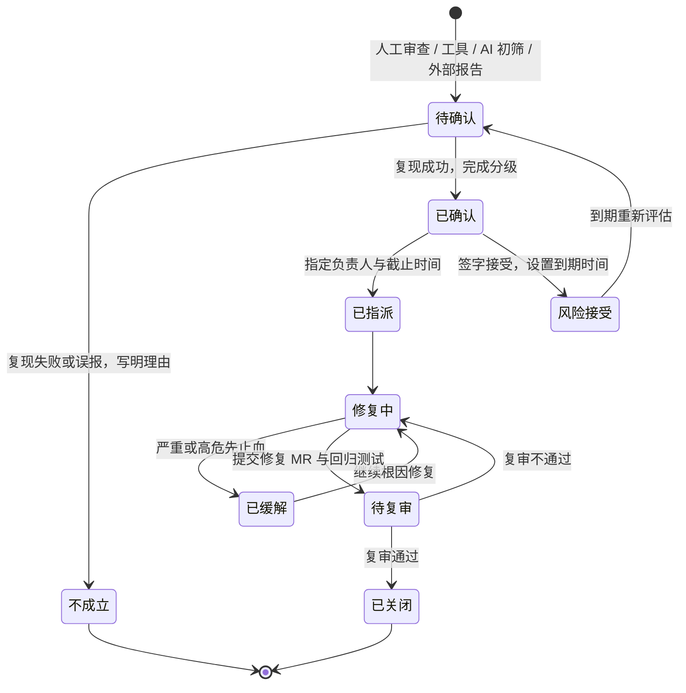

# 风险分级标准

适用于代码审计、MR 审查、外部报告（SRC / 白帽）以及工具和 AI 初筛产出的安全问题。目的是让同一类问题在不同人手里得到相同的等级，并且每个等级都对应明确的处理时限和签字人。

## 1. 等级定义

等级分为 严重 / 高 / 中 / 低 四档，“严重”是“高”之上的一档，单独列出是因为它的响应方式不同（需要立即止血）。

| 等级 | CVSS v3.1 基础分 | 业务含义 | 本平台典型例子 |
|---|---|---|---|
| 严重 | 9.0 – 10.0，或满足下方“严重”业务条件 | 无需特殊条件即可直接造成资金损失，或可批量接管账号、批量获取全量敏感数据 | 伪造支付回调使订单免费到账；普通玩家可调用后台调账接口给自己加币；未鉴权接口可直接修改他人余额 |
| 高 | 7.0 – 8.9，或满足下方“高”业务条件 | 可越权读写他人数据且可批量利用；需一定条件才能造成资金损失；可获取服务端凭据或进入内网 | 按订单号可查询他人订单且订单号可枚举；后台排序参数 SQL 注入；钱包并发扣减可透支；发货 Webhook SSRF 可读取云元数据 |
| 中 | 4.0 – 6.9 | 影响有限或利用条件较多：需要较高权限、需要用户交互、只影响单个用户、可导致局部拒绝服务、少量敏感信息泄露 | 批量接口无上限导致数据库压力；上传仅校验后缀导致存储型 XSS；日志打印令牌；TCC 悬挂导致单用户资金被冻结（可人工恢复） |
| 低 | 0.1 – 3.9 | 难以直接利用，主要是纵深防御缺失或信息泄露风险很小 | 缺少部分安全响应头；错误信息透出非敏感的内部错误码 |
| 信息 | 不评分 | 编码规范、可维护性、需要关注但当前不构成风险 | 硬编码的超时值；缺少注释的 `nolint` |

### 1.1 业务下限规则

CVSS 衡量的是技术层面的可利用性和影响，不直接衡量“平台损失了多少钱”。为避免资金类问题被 CVSS 低估，最终等级取 **CVSS 等级与业务下限中较高的一个**：

| 条件 | 最低等级 |
|---|---|
| 无需特殊条件（普通玩家或匿名）即可直接造成平台或用户资金损失（多发、少扣、免费到账、任意改余额） | 严重 |
| 需要竞态、特定时序或较高权限才能造成资金损失（透支、重复入账、付款不到账） | 高 |
| 可批量、可自动化地越权读取或修改他人数据 | 高 |
| 可获取服务端凭据（云元数据、密钥、令牌）或以服务端身份访问内网 | 高 |
| 批量泄露个人信息（手机号、身份证等），涉及合规上报义务 | 高 |
| 资金被冻结或延迟但不丢失，可人工恢复 | 中 |

降级只在存在确实有效的补偿控制时允许，例如“接口只在内网可达且有 NetworkPolicy 限制”。降级理由必须写进报告并由安全负责人确认。“攻击者不知道这个接口”“前端没有入口”不是有效的补偿控制。

### 1.2 CVSS 评分约定

为了让不同审计人员的打分一致，本平台约定：

- **PR（所需权限）**：匿名接口和支付回调为 `N`；普通玩家为 `L`；客服（cs）账号数量多且有外包人员，按 `L` 计；运营、财务、管理员按 `H` 计。
- **AC（攻击复杂度）**：能用脚本稳定复现的竞态按 `L`；依赖网络抖动、服务重启等攻击者无法控制的时序按 `H`。
- **S（作用域）**：SSRF 读取云元数据、存储型 XSS 在其他用户浏览器中执行，按 `C`。
- 可靠性缺陷（如消息丢失、无超时导致雪崩）不是由攻击者触发的，CVSS 只作参考，等级按业务下限判定，并在报告中注明。
- 报告中写完整向量（如 `CVSS:3.1/AV:N/AC:L/PR:L/UI:N/S:U/C:H/I:N/A:N`）和基础分，不写时间分和环境分。

## 2. 修复时限与签字

| 等级 | MR 阶段 | 线上已存在 | 风险接受签字 |
|---|---|---|---|
| 严重 | 阻断合并 | 发现后立即升级（电话 + 拉群）；2 小时内止血（下线接口、功能开关、网关规则等）；24 小时内修复上线；72 小时内完成同类代码排查和复盘 | 不接受风险，只能修复 |
| 高 | 阻断合并 | 24 小时内修复或缓解；缓解措施上线后 7 天内完成根因修复 | 技术负责人 + 安全负责人；资金类问题另需财务负责人知会 |
| 中 | 原则上在本 MR 修复；确需延期的登记例外并指定修复版本 | 2 个迭代（约 14 天）内修复 | 模块负责人 + 审计工程师 |
| 低 | 不阻断，登记跟踪 | 纳入技术债，90 天内处理或确认接受 | 模块负责人 |

说明：

- “阻断合并”通过 CI 状态检查实现：Semgrep / gosec / govulncheck 的高置信度规则失败即阻断；人工审查发现的高危及以上由审计工程师在 MR 上标记 Request changes。
- 风险接受必须有到期时间（最长 90 天），到期后重新评估，不允许永久接受。
- 时限从“确认”开始计算，不从“工具报出”开始计算；但确认本身也有时限：严重 / 高的候选问题要在 1 个工作日内完成人工确认。

## 3. 闭环流程

各阶段的产出：

| 阶段 | 负责人 | 产出 |
|---|---|---|
| 发现 | 审计工程师 / 开发 / 工具 | 问题描述、位置、来源（人工 / Semgrep / gosec / AI / 外部） |
| 确认与分级 | 审计工程师 | 复现结论（在测试环境或单元测试中复现）、CVSS 向量、业务下限判定、最终等级、CWE |
| 指派 | 模块负责人 | 修复负责人、截止时间（按第 2 节时限） |
| 修复 | 修复负责人 | 修复 MR，必须包含回归测试；如需先止血，单独记录缓解措施 |
| 复审验收 | 审计工程师（不能是修复人本人） | 复审记录，见第 4 节 |
| 关闭 | 审计工程师 | 关闭日期、关联 MR 与测试名；同类排查结果 |

## 4. 复审必须确认的内容

复审不是“看一眼 MR 能合就行”，以下每项都要在复审记录里写明结论：

1. **有回归测试，并且测试能区分修复前后**：把修复回退后测试应当失败。测试名要写进报告，例如越权问题对应 `TestHorizontalPrivilegeEscalationBlocked`。只验证“正常路径能通过”的测试不算回归测试。
2. **修的是根因，不是症状**：
   - 越权问题要在查询条件中加入归属，而不是在 handler 里事后比较 `order.UserID != uid`（下一个调用这个查询的地方还会出问题）。
   - SQL 注入要用白名单 / 参数化，而不是过滤关键字或转义引号。
   - SSRF 要在建立连接时校验，而不是只在保存时校验一次。
   - 鉴权遗漏要改为“挂在分组上 + 全路由测试”，而不是给漏掉的那一个路由补上中间件。
3. **同类代码已排查**：用 Semgrep 规则或 grep 搜索同一模式，列出排查范围和结果（如“搜索 `Where(\"order_no = ?\"`，共 3 处，2 处已带 user_id，1 处为支付回调，属于设计如此”）。能写成规则的，要补充 Semgrep 自定义规则，防止再次出现。
4. **修复没有引入新问题**：例如加了限流后，确认 Redis 故障时的降级行为；加了验签后，确认业务失败时 nonce 会释放，渠道重试不会被误判为重放。
5. **线上影响已评估**：问题存在期间是否已被利用（查访问日志、审计日志、对账差异）；资金类问题需要给出影响金额或确认无损失。
6. **缓解措施已撤除或转为常态**：临时网关规则、功能开关在根因修复后要明确处理方式。

任一项不满足，状态回到“修复中”。

## 5. AI 初筛结果的处理

AI 辅助审查用于扩大初筛覆盖面，不作为判定依据：

- AI 产出的所有问题一律进入“待确认”，由审计工程师复现后才能进入“已确认”。AI 给出的等级只作参考，最终等级按本文第 1 节重新评定。
- AI 结果**不能自动阻断合并，也不能自动关闭问题**。阻断合并只来自规则明确、误报率可控的确定性工具（Semgrep 高置信度规则、gosec、govulncheck）和人工审查结论。
- AI 判定“不成立”的问题同样需要人工确认后才能关闭，不能因为 AI 复审说“已修复”就关闭。
- 误报要记录原因（如“已参数化”“该接口由签名鉴权，不存在用户会话”），定期统计误报率，并据此调整提示词或改写成确定性规则。
- 外发给外部模型的代码片段和日志，需先经 [mask.Text](../../pkg/mask/mask.go) 脱敏，并去掉密钥、内网地址、真实用户数据；涉及资金核心逻辑的代码只能使用内部部署的模型。
- 报告中注明每个问题的来源（人工 / 工具 / AI），便于统计各渠道的有效检出率。

示例见 [sample-report.md](sample-report.md) 中的 GP-AUD-013（AI 与 Semgrep 均报出、经人工判定不成立）以及 GP-AUD-009（AI 初评为高危、人工复核后定为中危）。
